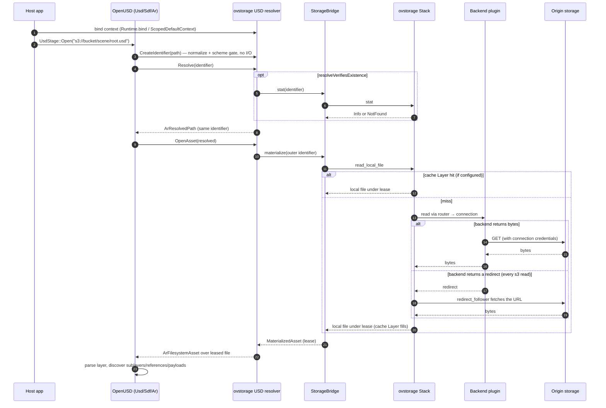
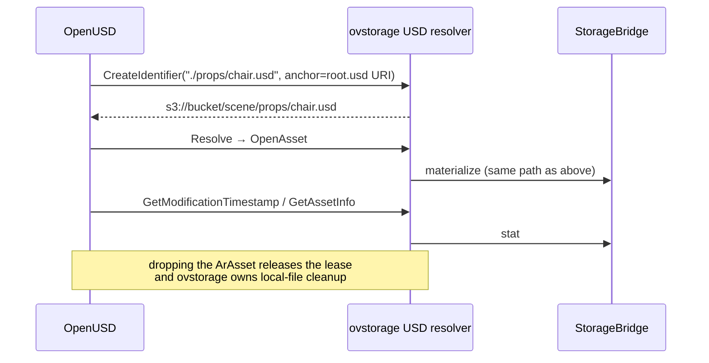
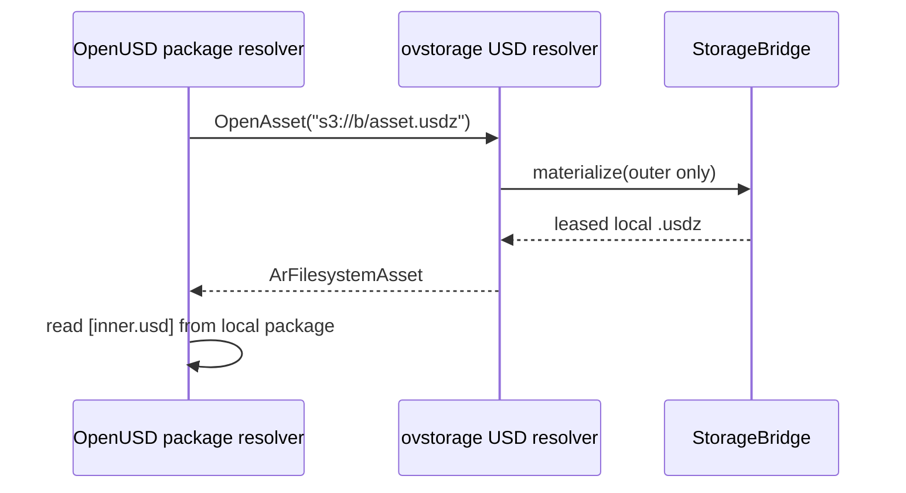
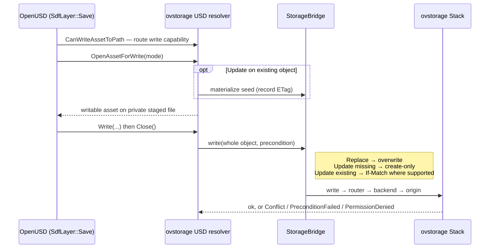

# How USD content flows through ovstorage

This page follows one USD request from `UsdStage::Open` to the bytes on a storage backend and back. It explains what each component does, when data is actually fetched, and how saves reach storage. Exact contracts are in the resolver [architecture reference](../ovstorage-usd-resolver/docs/architecture.md) and [configuration reference](../ovstorage-usd-resolver/docs/configuration.md).

## The pieces

| Component | Responsibility |
| --- | --- |
| **OpenUSD** (`Usd`, `Sdf`, `Ar`) | Composes stages, parses layers, owns package (USDZ) internals, and keeps opened layers in its layer registry |
| **ovstorage USD resolver** | An `ArResolver` URI plugin. It decides which asset paths are remote, anchors relative paths, enforces the scheme gate, and hands OpenUSD local files for remote objects |
| **StorageBridge** | The narrow contract between the resolver and ovstorage: `stat`, read, `materialize`, and write, with normalized errors |
| **ovstorage Stack** | The Layers declared in `ovstorage.toml`: optional wrappers (cache, retry, redirect, alias), a router, and backend plugins holding connections and credentials |
| **Origin** | The storage service itself, such as an S3 bucket, an HTTP server, or a local filesystem |

The resolver holds no byte cache and no credentials. Caching, routing, retries, and authentication are all configured on the ovstorage side.

## What the resolver claims

The resolver registers for the URI schemes advertised at build time (`OVS_USD_RESOLVER_URI_SCHEMES`, default `s3;http;https;hf`). OpenUSD reads that list from the plugin's `plugInfo.json` when it discovers plugins. A runtime may narrow the list but can't widen it. The configured ovstorage
stack supplies routing and backend capabilities; there is no special ban on
`omni` or `omniverse`. As with any additional scheme, they require registration
and an appropriate provider route. Avoid competing resolver registrations.

| Asset path | Handled by |
| --- | --- |
| Absolute URI in a claimed scheme, such as `s3://bucket/scene/root.usd` | This resolver |
| Relative path inside a remote layer, such as `./props/chair.usd` | This resolver, anchored to the layer's URI |
| Local file or bare search path | OpenUSD's default filesystem resolver; ovstorage is never involved |
| URI in a scheme not advertised by this build | Another registered resolver, if any |

Remote calls reach ovstorage only while a resolver context naming a runtime is bound on the calling thread. In Python that is `Runtime(config).bind()`. In C++ it is `setDefaultResolverRuntime` with `ScopedDefaultContext`, or `ArResolverContextBinder` with `makeOpenUsdResolverContext`. Each worker thread binds its own context.

## Opening a remote stage



1. **Identify.** `CreateIdentifier` normalizes the path, or joins a relative path to its anchor, and checks the scheme. No storage I/O happens.
2. **Resolve.** By default `Resolve` returns the identifier unchanged, so resolution costs nothing. Hosts that need `Resolve` to prove existence turn on `resolveVerifiesExistence`. It issues a `stat` and caches only successes and authoritative `NotFound` results, with time limits and a size bound.
3. **Open.** `OpenAsset` strips any SDF format arguments and package inner path, then asks the bridge to **materialize** the outer object. OpenUSD gets an ordinary `ArFilesystemAsset` over a local file. That file stays valid as long as the asset holds its lease.
4. **Compose.** OpenUSD parses the layer and repeats the same steps for each sublayer, reference, and loaded payload.

## Inside the ovstorage Stack

A `materialize` call travels through the Layers the configuration declares, from the outermost one inward:

- **Wrappers**, where configured. `byte_cache` returns a cached local file under a lease, or fills on a miss. `metadata_cache` serves `stat`. `retry` and `redirect_follower` change how failures and redirects are handled. A Stack without a wrapper has none of its behavior, so an `s3` Stack needs `redirect_follower`: the S3 plugin answers every read with a redirect that the follower fetches.
- The **router** chooses the connection that serves the address prefix.
- The **backend plugin** speaks the provider protocol to the origin with that connection's credentials.

A `file` backend returns the file's own path without copying. For remote backends, the Stack or the bridge provides the local file. If no Layer can produce a local file, the bridge reads the whole object into a temporary file whose lease deletes it on release. Either way, ovstorage, not the resolver, decides when local files are cleaned up. Ownership details are in the [Layer ownership registry](../ovstorage/docs/public/plugin-storage/OWNERSHIP.md).

## Dependencies, metadata, and reloads



- `GetModificationTimestamp` reports the backend's modification time from `stat`. OpenUSD uses it to decide whether a layer needs reloading.
- `GetAssetInfo` sets `version` from the provider's object version or its ETag, and fills `resolverInfo` with `url`, `size`, and `etag`.
- OpenUSD keeps opened layers in its registry, so reopening a stage in the same process may fetch nothing. Payloads opened with `UsdStage::LoadNone` aren't fetched until they're loaded.

## Packages (USDZ)



Only the outer package is fetched. OpenUSD's package resolver then reads its members from the local file. A relative path inside a package stays package-relative. An absolute URI inside a package resolves on its own. Errors distinguish a missing outer package from a missing inner member.

## Saving to remote storage



Writes upload whole objects:

- `CanWriteAssetToPath` checks that the route can be written. It is a capability check, not a permission guarantee; permission and quota failures appear at `Close`.
- Package members can't be written individually. To replace a package, name the outer `.usdz` directly.
- A rejected precondition is reported as `Conflict` or `PreconditionFailed` and is never retried as an overwrite.
- The shipped HTTP provider is read-only.

## When something fails

The resolver never reports authentication, routing, transient, or backend errors as a missing asset. Only an authoritative storage `NotFound` means absent. When OpenUSD can't open a remote layer, check the storage connection first (`ovstorage list-connections`, then `ovstorage list <address>`). Then watch the resolver:

```sh
ovstorage-usd-resolver doctor --uri s3://bucket/scene/root.usd --stack-config ovstorage.toml
ovstorage-usd-resolver trace s3://bucket/scene/root.usd --stack-config ovstorage.toml --json
```

`trace` reports each operation, such as `create_identifier`, `resolve`, and `open_asset`, with its storage status. Credentials are redacted from identifiers and messages. See the [CLI reference](../ovstorage-usd-resolver/docs/cli-reference.md).

## Related

- [Resolver configuration](../ovstorage-usd-resolver/docs/configuration.md): options, context binding, and the existence cache.
- [ovstorage configuration](../ovstorage/docs/public/configuration.md): Layers, connections, caches, and credentials.
- [Embedding example](../ovstorage-usd-resolver/examples/embed_resolver/): a runnable host that loads providers, builds a Stack, binds a context, and opens a stage.
