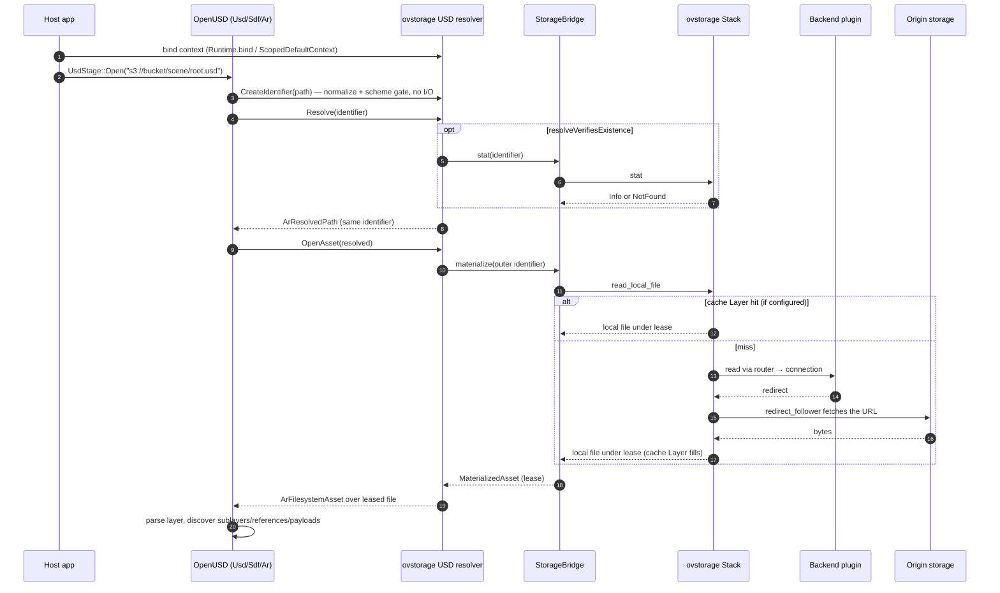
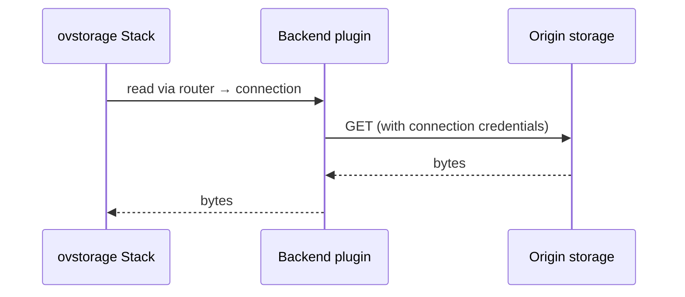
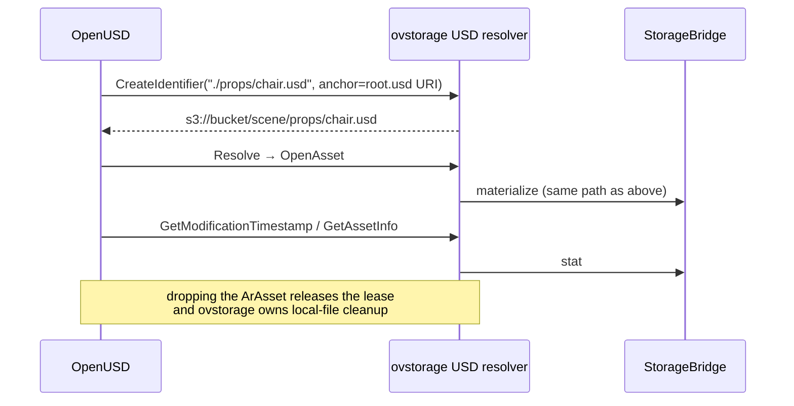
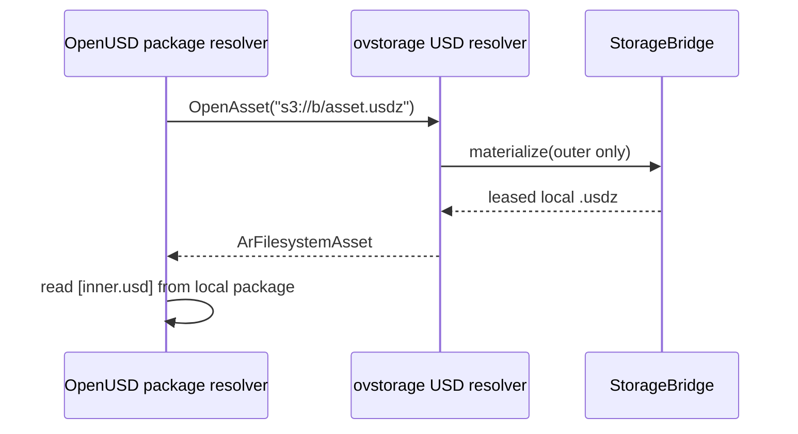
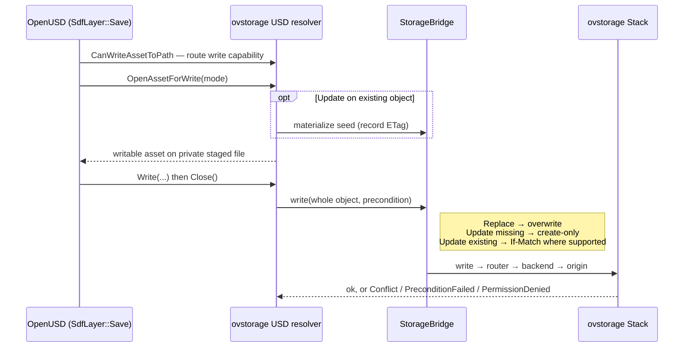

Up: [USD workflows](README.md)

# Sequence diagrams on request

Draw diagrams in Mermaid `sequenceDiagram` unless the caller asks for another format. Base them on the templates below, then fit them to the caller's setup:

1. **Ask or infer the setup:** the backend scheme, the Layers declared in their `ovstorage.toml` (show only those), whether `resolveVerifiesExistence` is on, whether the asset is a USDZ package, and whether the operation reads, writes, or both.
2. **Draw only what runs.** Leave out wrappers that aren't configured. The template below is for `s3`, whose reads always redirect, so its miss path goes through `redirect_follower`. For a backend that returns bytes itself, swap in the [direct read](#backend-that-returns-bytes) miss path. Show a cache hit and a miss as an `alt` block. Show optional steps as `opt` blocks.
3. **Ground it.** When a build is available, run `ovstorage-usd-resolver trace <uri> --stack-config ovstorage.toml --json`. Order the resolver steps by the trace events, such as `create_identifier.*`, `resolve.*`, and `open_asset.*`. Say whether the diagram is traced or derived from source.
4. Behavior rules are in [data-flow.md](data-flow.md). Don't invent steps that aren't there.
5. **Keep `;` out of message and note text.** Mermaid reads it as a statement separator and the diagram fails to render; write "and" or break the line with ` `.

## Open a remote `s3` stage

## Backend that returns bytes

For a backend that serves reads without a redirect, replace the miss path's backend steps with these. Draw no `redirect_follower` step:

## Each dependency

Repeat this block for each sublayer, reference, or loaded payload:

## USDZ

Use this variation for a package:

## Save to remote storage

